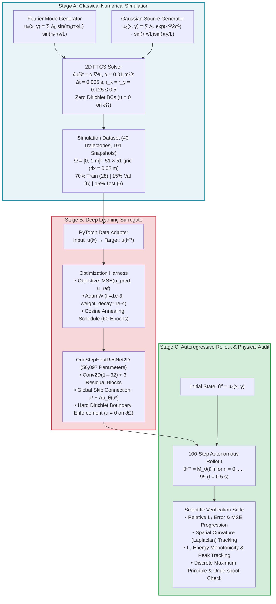
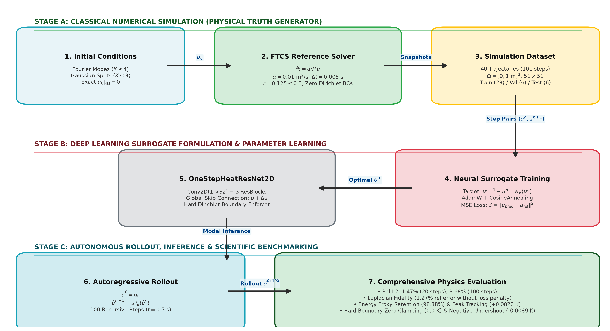
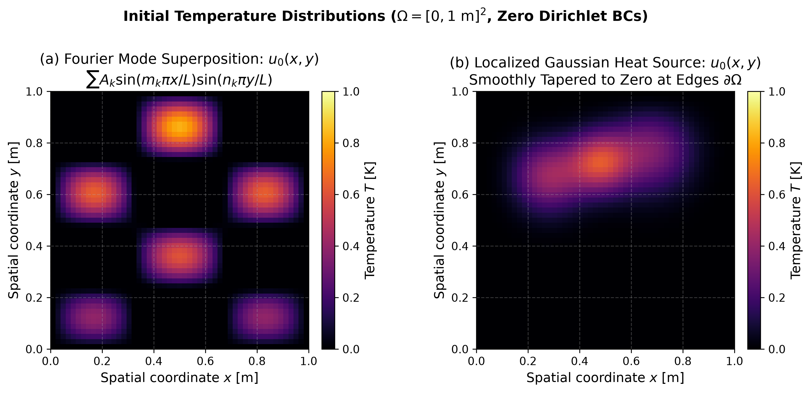
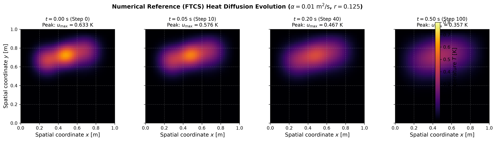
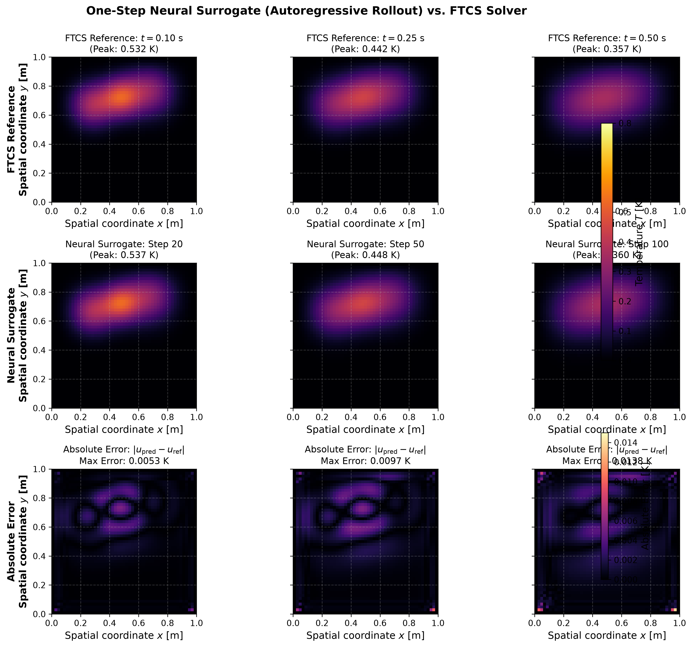
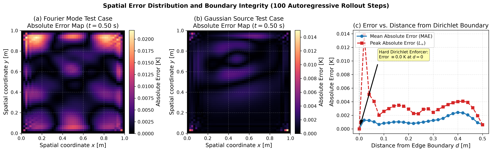
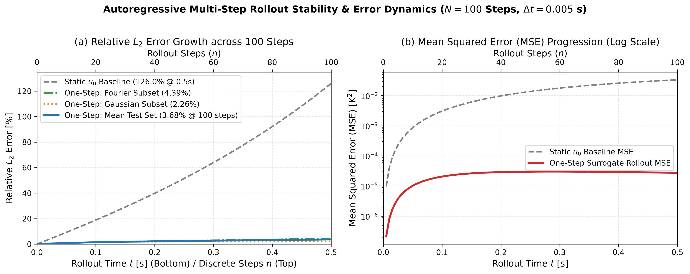
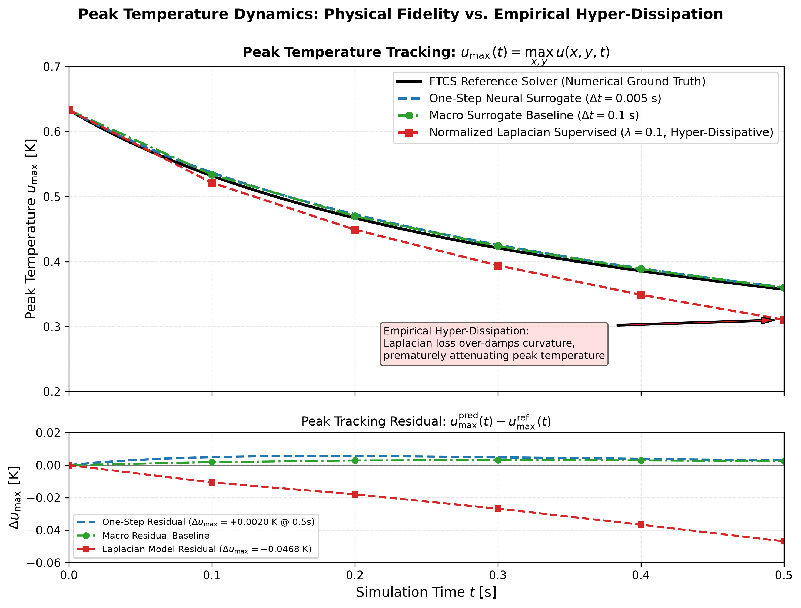
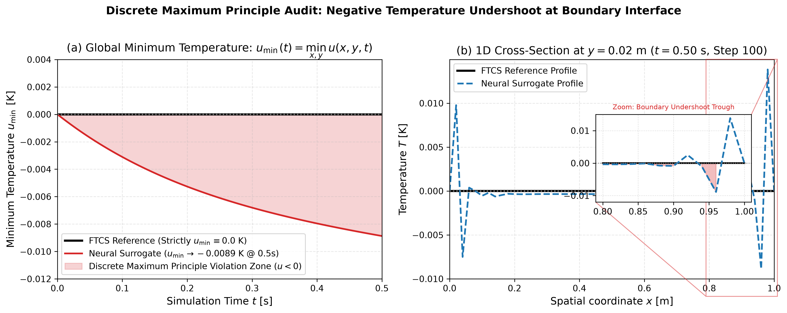

# physics-ml-lab: 2D Heat Diffusion Solver & Neural Surrogate Benchmark

[](tests/)
[](pyproject.toml)
[](pyproject.toml)

A reproducible scientific computing and machine learning laboratory implementing a classical two-dimensional Forward-Time Central-Space (FTCS) finite-difference heat diffusion solver and training a compact residual convolutional neural network (CNN) surrogate to approximate its discrete time-stepping operator.

> [!NOTE]
> **Scope & Engineering Clarification:** This repository is a **computational and numerical surrogate benchmark**, designed to study operator learning, multi-step autoregressive stability, physical invariant preservation, and failure modes. It is **not** an experimentally validated real-world thermal simulator for physical hardware.

---

## 1. Project Overview & System Architecture

This project investigates the interface between classical numerical PDE methods and deep learning surrogates. The primary surrogate model (`OneStepHeatResNet2D`) learns the discrete mapping:

$$u^n \mapsto u^{n+1} \quad \text{where } \Delta t = 0.005\text{ s}$$

Rather than attempting to learn continuous physical ground truth directly, the neural network explicitly targets the **discrete FTCS numerical update operator**, inheriting the truncation characteristics of the underlying finite-difference discretization.



---

## 2. Why This Project

In scientific and industrial simulation pipelines, replacing iterative linear or non-linear numerical solvers with deep neural networks promises multi-order-of-magnitude inference acceleration. However, evaluating a neural surrogate solely by single-step validation loss masks critical failure modes encountered in engineering deployment:

1. **Autoregressive Compounding Error:** When a surrogate recursively feeds its output back as its next input ($\hat{u}^{n+1} = \mathcal{M}_\theta(\hat{u}^n)$), small high-frequency residual errors compound over time, potentially causing numerical divergence or unphysical drift.
2. **Physical Invariant Violations:** Unconstrained deep learning models do not inherently satisfy conservation laws, boundary constraints, or the maximum principle.
3. **Spectral Degradation:** Convolutional architectures often display spectral bias toward dominant low-frequency modes, distorting sharp localized gradients.

This laboratory provides an end-to-end framework to examine whether a compact convolutional neural network can accurately emulate a discrete numerical diffusion operator, maintain stability across a 100-step rollout horizon, and adhere to physical invariants.

---

## 3. Key Results

All evaluation metrics are taken directly from the authoritative benchmark report (`outputs/models/onestep_surrogate_evaluation_report.json`), evaluated on the 6 held-out test simulations (600 consecutive transition pairs, 4 Fourier trajectories, 2 Gaussian trajectories).

### 3.1 Single-Step Operator Accuracy ($u^n \mapsto u^{n+1}$, $\Delta t = 0.005\text{ s}$)

| Metric | Overall Test Split (600 pairs) | Fourier Subset (400 pairs) | Gaussian Subset (200 pairs) | Identity Baseline ($\hat{u}^{n+1} = u^n$) | Surrogate vs. Identity |
|:---|:---:|:---:|:---:|:---:|:---:|
| **Mean Squared Error (MSE)** | **$4.248 \times 10^{-8}\text{ K}^2$** | $6.180 \times 10^{-8}\text{ K}^2$ | $3.847 \times 10^{-9}\text{ K}^2$ | $3.729 \times 10^{-6}\text{ K}^2$ | **$87.8\times$ lower MSE** |
| **Root Mean Squared Error (RMSE)** | **$2.061 \times 10^{-4}\text{ K}$** | $2.486 \times 10^{-4}\text{ K}$ | $6.202 \times 10^{-5}\text{ K}$ | $1.931 \times 10^{-3}\text{ K}$ | **$9.4\times$ lower RMSE** |
| **Relative $L_2$ Error (Sample Mean)** | **$0.0719\%$** | $0.0823\%$ | $0.0511\%$ | $0.7677\%$ | **$10.7\times$ lower error** |
| **Relative $L_2$ Error (Global Frobenius)** | **$0.0940\%$** | $0.0965\%$ | $0.0574\%$ | $0.8802\%$ | **$9.4\times$ lower error** |
| **Peak Absolute Error ($L_\infty$)** | **$0.003443\text{ K}$** | $0.003443\text{ K}$ | $0.001332\text{ K}$ | $0.017214\text{ K}$ | **$5.0\times$ lower max error** |
| **Spatial Laplacian Relative Error** | **$1.270\%$** | $1.391\%$ | $1.040\%$ | *N/A* | Accurate curvature tracking |
| **Outer Boundary Error** | **$0.000\text{ K}$ (Exact)** | $0.000\text{ K}$ (Exact) | $0.000\text{ K}$ (Exact) | $0.000\text{ K}$ | Exact Dirichlet satisfaction |

#### Understanding the Metrics:
- **Why the Identity Baseline Matters:** Because $\Delta t = 0.005\text{ s}$ is small, the physical field changes incrementally ($|\Delta u| \sim 10^{-3}\text{ K}$). A trivial identity operator ($\hat{u}(t + \Delta t) = u(t)$) already yields an MSE of $3.73 \times 10^{-6}\text{ K}^2$ and $<0.8\%$ relative $L_2$ error. Comparing against the identity baseline is necessary to prove the model has learned the true diffusion dynamics rather than temporal persistence.
- **Sample-Mean vs. Global Frobenius Relative $L_2$:**
  - *Sample-Mean Relative $L_2$:* $\frac{1}{N}\sum_{k=1}^N \frac{\|u_k^{\text{pred}} - u_k^{\text{ref}}\|_2}{\|u_k^{\text{ref}}\|_2}$. Computes error per snapshot pair and averages uniformly, weighting every snapshot equally regardless of absolute field amplitude.
  - *Global Frobenius Relative $L_2$:* $\frac{\sqrt{\sum_{k=1}^N \|u_k^{\text{pred}} - u_k^{\text{ref}}\|_F^2}}{\sqrt{\sum_{k=1}^N \|u_k^{\text{ref}}\|_F^2}}$. Normalizes total squared point-wise errors across all snapshots by the total squared reference norm, giving greater weight to early high-energy states.

### 3.2 Autonomous Multi-Step Autoregressive Rollout ($1 \to 100$ Steps)

In rollout mode, the model recursively feeds its predictions back as inputs ($\hat{u}^{n+1} = \mathcal{M}_\theta(\hat{u}^n)$) across 100 steps ($t = 0.50\text{ s}$ physical time):

| Rollout Step ($n$) | Physical Time ($t$) | Overall Rel $L_2$ | Fourier Rel $L_2$ | Gaussian Rel $L_2$ | Gaussian Peak Error | $L_2$ Energy Retention ($H_{\text{pred}}/H_{\text{ref}}$) | Static Baseline Rel $L_2$ |
|:---:|:---:|:---:|:---:|:---:|:---:|:---:|:---:|
| **Step 1** | $0.005\text{ s}$ | **$0.072\%$** | $0.082\%$ | $0.051\%$ | $+0.0000\text{ K}$ | $99.99\%$ | $0.91\%$ |
| **Step 20** | $0.10\text{ s}$ | **$1.469\%$** | $1.499\%$ | $1.409\%$ | $+0.0044\text{ K}$ ($+0.74\%$) | $99.43\%$ | $18.89\%$ |
| **Step 40** | $0.20\text{ s}$ | **$2.203\%$** | $2.351\%$ | $1.908\%$ | $+0.0058\text{ K}$ ($+1.18\%$) | $98.99\%$ | $39.87\%$ |
| **Step 100** | $0.50\text{ s}$ | **$3.681\%$** | $4.392\%$ | $2.261\%$ | $+0.0020\text{ K}$ ($+0.60\%$) | **$98.38\%$** | **$126.00\%$** |

> [!WARNING]
> **Empirical Result vs. Stability Guarantee:** The 100-step rollout performance ($3.681\%$ relative $L_2$ error at $t = 0.50\text{ s}$) is an **empirical benchmark** measured on the 6 held-out test trajectories under the specified numerical parameters. It is **not** a mathematical proof or universal guarantee of numerical stability for arbitrary rollout durations, unconstrained initial condition families, or differing grid spacings.

---

## 4. Visual Results

The 8 publication figures below demonstrate the workflow, field comparisons, rollout error accumulation, and failure modes. All figures are generated from the verification scripts into `outputs/figures/publication/`.

### 4.1 System Architecture & Initial Conditions

| Figure 8: End-to-End Workflow Diagram | Figure 1: Initial Condition Distributions |
|:---:|:---:|
|  |  |
| *Figure 8: Overview of dataset generation, residual CNN architecture, recursive rollout, and physical auditing.* | *Figure 1: Initial temperature fields for orthogonal Fourier modes (left) and boundary-tapered Gaussian sources (right).* |

### 4.2 Numerical Reference Solver & Neural Surrogate Comparison

| Figure 2: FTCS Numerical Reference Evolution | Figure 3: Neural Surrogate vs. FTCS Reference |
|:---:|:---:|
|  |  |
| *Figure 2: FTCS diffusion time series across 0.5 s for test trajectory `sim_gaussian_0019` ($\alpha = 0.01\text{ m}^2/\text{s}$, peak decaying from $0.633\text{ K}$ to $0.357\text{ K}$).* | *Figure 3: Side-by-side comparison between recursive neural rollout and FTCS reference at $t=0.10\text{ s}$, $0.25\text{ s}$, and $0.50\text{ s}$.* |

### 4.3 Error Heatmaps & Rollout Error Growth

| Figure 4: Spatial Error Heatmaps | Figure 5: Autoregressive Rollout Error Growth |
|:---:|:---:|
|  |  |
| *Figure 4: Pointwise absolute error $|u - \hat{u}|$ at $t=0.1\text{ s}, 0.25\text{ s}, 0.5\text{ s}$ and radial error decay away from boundaries.* | *Figure 5: Autoregressive error progression over 100 steps: relative $L_2$ error (left) and log MSE (right) compared to static baseline.* |

### 4.4 Peak Evolution & Maximum Principle Failure Mode

| Figure 6: Peak Temperature Evolution | Figure 7: Maximum Principle Violation Audit |
|:---:|:---:|
|  |  |
| *Figure 6: Peak temperature decay for reference vs. one-step surrogate vs. Laplacian-penalized models, highlighting hyper-dissipation.* | *Figure 7: Discrete maximum principle audit showing negative-temperature undershoot ($u_{\min} \to -0.0089\text{ K}$) near the boundary interface.* |

---

## 5. Physics and Numerical Formulation

### 5.1 Governing Heat Diffusion Equation
Thermal diffusion in an isotropic, homogeneous two-dimensional square solid $\Omega = [0, L_x] \times [0, L_y]$ is described by the parabolic partial differential equation:

$$\frac{\partial u}{\partial t} = \alpha \nabla^2 u = \alpha \left( \frac{\partial^2 u}{\partial x^2} + \frac{\partial^2 u}{\partial y^2} \right)$$

where:
- $u(x, y, t) = T(x, y, t) - T_{\text{ref}}$ is the spatial **temperature deviation** in Kelvin $[\text{K}]$ relative to an ambient reference temperature $T_{\text{ref}}$.
- $\alpha = \frac{k}{\rho c_p} = 0.01\text{ m}^2/\text{s}$ is the thermal diffusivity, balancing thermal conductivity $k$ against volumetric heat capacity $\rho c_p$.
- $\nabla^2 = \frac{\partial^2}{\partial x^2} + \frac{\partial^2}{\partial y^2}$ is the two-dimensional Laplace operator representing local spatial curvature.

### 5.2 Boundary Conditions & Physical Interpretation
Homogeneous (zero) Dirichlet boundary conditions are imposed along the entire perimeter:

$$u(x, y, t) = 0.0\text{ K} \quad \forall (x, y) \in \partial \Omega, \; t \ge 0$$

Because $u$ is defined as deviation from ambient ($u = T - T_{\text{ref}}$), this represents plate boundaries maintained at the ambient reference temperature $T_{\text{ref}}$, **not absolute zero Kelvin** ($0\text{ K}$ absolute). Consequently, local values $u < 0$ indicate temperatures cooling below the ambient reference temperature, not unphysical negative thermodynamic states.

### 5.3 FTCS Discretization & Numerical Stability
The continuous domain is discretized on a uniform Cartesian grid with spatial spacing $h = \Delta x = \Delta y = \frac{L_x}{N_x - 1} = 0.02\text{ m}$ ($N_x = N_y = 51$) and temporal step $\Delta t = 0.005\text{ s}$.

Using a forward difference in time and standard second-order central differences in space:

$$\frac{u_{i, j}^{n+1} - u_{i, j}^n}{\Delta t} = \alpha \left( \frac{u_{i+1, j}^n - 2u_{i, j}^n + u_{i-1, j}^n}{\Delta x^2} + \frac{u_{i, j+1}^n - 2u_{i, j}^n + u_{i, j-1}^n}{\Delta y^2} \right)$$

Defining the dimensionless mesh Fourier numbers $r_x = \frac{\alpha \Delta t}{\Delta x^2}$ and $r_y = \frac{\alpha \Delta t}{\Delta y^2}$, the isotropic update equation becomes:

$$u_{i, j}^{n+1} = u_{i, j}^n + \frac{\alpha \Delta t}{h^2} \nabla_h^2 u_{i, j}^n$$

where $\nabla_h^2 u_{i, j}^n = u_{i+1, j}^n + u_{i-1, j}^n + u_{i, j+1}^n + u_{i, j-1}^n - 4u_{i, j}^n$ is the discrete 5-point Laplacian stencil.

- **Von Neumann Stability Condition:** For error modes not to amplify ($|\xi| \le 1$), the 2D FTCS scheme requires:
  $$r_x + r_y = \alpha \Delta t \left( \frac{1}{\Delta x^2} + \frac{1}{\Delta y^2} \right) \le \frac{1}{2}$$
  In our configuration:
  $$r_x = r_y = \frac{0.01 \times 0.005}{0.02^2} = \frac{0.00005}{0.0004} = 0.125 \implies r_x + r_y = 0.250 \le 0.500$$
  The scheme operates in the stable diffusion regime with a $2\times$ safety margin.
- **Discrete Maximum Principle:** When $r_x + r_y \le 0.5$, rewriting the update equation as a convex combination:
  $$u_{i, j}^{n+1} = (1 - 2r_x - 2r_y) u_{i, j}^n + r_x (u_{i+1, j}^n + u_{i-1, j}^n) + r_y (u_{i, j+1}^n + u_{i, j-1}^n)$$
  reveals that all stencil coefficients are strictly non-negative and sum to $1.0$. Thus, for any non-negative initial field $u_0 \ge 0$, the numerical FTCS solution strictly satisfies $u_{i, j}^n \ge 0$ for all time steps.

### 5.4 Energy Proxy vs. Internal Energy
Thermal dissipation is audited using the integrated squared $L_2$ norm:

$$H(t) = \iint_\Omega u^2(x, y, t) \, dx \, dy \approx \sum_{i, j} \left( u_{i, j}^n \right)^2 \Delta x \Delta y$$

For the continuous heat equation with homogeneous Dirichlet boundaries, $\frac{dH}{dt} = -2\alpha \int_\Omega \|\nabla u\|^2 \le 0$. 

*Clarification:* This functional $H(t)$ is a **mathematical Lyapunov energy proxy** indicating monotonic spatial smoothing and $L_2$ stability. It is **not** the thermodynamic internal energy of the plate ($E = \iint_\Omega \rho c_p T \, dx \, dy$).

---

## 6. Dataset Generation & Splitting Protocol

### 6.1 Initial Condition Families
Data is generated across two initial condition families on $\Omega = [0, 1.0\text{ m}]^2$:

1. **Orthogonal Fourier Mode Superpositions (`FourierModeGenerator`):**
   $$u_0(x, y) = \sum_{k=1}^K A_k \sin\left(\frac{m_k \pi x}{L_x}\right) \sin\left(\frac{n_k \pi y}{L_y}\right)$$
   where $m_k, n_k \in \{1, 2, 3, 4\}$, $K \le 4$, and amplitudes $A_k$ are randomly sampled such that peak $u_0 \in [0.5, 1.0]\text{ K}$. These modes analytically satisfy zero Dirichlet conditions on all four edges.
2. **Boundary-Tapered Gaussian Heat Sources (`GaussianSourceGenerator`):**
   $$u_{\text{raw}}(x, y) = \sum_{k=1}^K A_k \exp\left( - \frac{(x - x_k)^2 + (y - y_k)^2}{2 \sigma_k^2} \right)$$
   To enforce exact boundary adherence without discontinuity, the raw field is multiplied by a smooth boundary envelope:
   $$u_0(x, y) = u_{\text{raw}}(x, y) \cdot \sin\left(\frac{\pi x}{L_x}\right) \sin\left(\frac{\pi y}{L_y}\right)$$
   with source centers $(x_k, y_k) \in [0.15 L, 0.85 L]$ and standard deviations $\sigma_k \in [0.08, 0.15]\text{ m}$.

### 6.2 Trajectory-Level Partitioning (Zero Leakage)
Splitting is executed **strictly by originating simulation ID** to prevent temporal data leakage:
- **Total Synthesized Simulations:** 40 independent trajectories (20 Fourier, 20 Gaussian).
- **Simulation Trajectory Length:** 101 snapshots over $t \in [0, 0.5\text{ s}]$ with $\Delta t = 0.005\text{ s}$ (100 consecutive transition pairs per simulation).
- **Training Set (70%):** 28 simulations $\to$ 2,800 consecutive transition pairs.
- **Validation Set (15%):** 6 simulations $\to$ 600 consecutive transition pairs.
- **Held-Out Test Set (15%):** 6 simulations (4 Fourier, 2 Gaussian) $\to$ 600 consecutive transition pairs.

Because splitting is performed at the trajectory level, no intermediate snapshot, parameter configuration, or spatial profile from any test simulation is present in the training set ($\text{Train} \cap \text{Val} = \emptyset$, $\text{Train} \cap \text{Test} = \emptyset$).

---

## 7. Neural Surrogate Architecture

### 7.1 Residual Formulation
Because heat diffusion over $\Delta t = 0.005\text{ s}$ modifies temperatures by small increments ($|\Delta u| \sim 10^{-3}\text{ K}$), predicting $u^{n+1}$ directly leads to vanishing gradients. The network is parameterized to predict the **discrete temporal residual increment**:

$$u^{n+1} = u^n + \mathcal{R}_\theta(u^n)$$

Aligning with the FTCS update $u^{n+1} = u^n + \frac{\alpha \Delta t}{h^2} \nabla_h^2 u^n$, the network parameterizes an empirical spatial operator:

$$\mathcal{R}_\theta(u^n) \approx 0.125 \, \nabla_h^2 u^n$$

```
Input Field: u(t)  [B, 1, 51, 51]
  │
  ├─── Global Skip Connection ───────────────────────┐
  │                                                  │
  ▼                                                  │
Conv2D (1 → 32, 3×3, pad 1) + GELU                   │
  │                                                  │
Residual Block 1 (Conv 32→32, GELU, Conv 32→32) + ID │
  │                                                  │
Residual Block 2 (Conv 32→32, GELU, Conv 32→32) + ID │
  │                                                  │
Residual Block 3 (Conv 32→32, GELU, Conv 32→32) + ID │
  │                                                  │
Conv2D (32 → 1, 3×3, pad 1)                          │
  │                                                  │
  ▼                                                  │
Residual Increment: Δu_θ [B, 1, 51, 51]              │
  │                                                  │
  ▼                                                  ▼
Summation: u_raw = u(t) + Δu_θ  ─────────────────────┘
  │
  ▼
Hard Dirichlet Boundary Clamping: u_pred[∂Ω] = 0.0 K
  │
Output Field: u(t + Δt)  [B, 1, 51, 51]
```

### 7.2 Structural Specifications
- **Class:** `OneStepHeatResNet2D`
- **Total Trainable Parameters:** 56,097
- **Hidden Channels:** 32
- **Residual Blocks:** 3
- **Activation:** GELU
- **Hard Boundary Constraint:** Boundary nodes ($i \in \{0, N_x-1\}$ or $j \in \{0, N_y-1\}$) are explicitly masked to zero in the forward computation graph, guaranteeing zero Dirichlet satisfaction with zero training error.

---

## 8. Experiments and Lessons Learned

### 8.1 Sobolev / Laplacian Regularization Experiments
To test whether penalizing spatial derivative errors improves physical fidelity, we investigated augmenting the standard MSE objective with a discrete Laplacian supervision term:

$$\mathcal{L}_{\text{total}} = \mathcal{L}_{\text{MSE}} + \lambda \, \mathcal{L}_{\text{Lap}} \quad \text{where } \mathcal{L}_{\text{Lap}} = \text{MSE}\left(\nabla_h^2 u_{\text{pred}}, \nabla_h^2 u_{\text{ref}}\right)$$

We evaluated both unnormalized ($\lambda \in \{0.001, 0.01\}$) and scale-normalized configurations ($\lambda \in \{0.01, 0.05, 0.1\}$ with $S_{\text{lap}}^2 = 219.94\text{ K}^2/\text{m}^4$).

| Configuration | Single-Step Rel $L_2$ | Rel Laplacian Error | 100-Step Rollout Rel $L_2$ | $L_2$ Energy Retention ($t=0.5\text{ s}$) |
|:---|:---:|:---:|:---:|:---:|
| **Baseline ($\lambda = 0$, One-Step MSE)** | **$0.072\%$** | **$1.27\%$** | **$3.68\%$** | **$98.38\%$** |
| Normalized Laplacian ($\lambda = 0.01$) | $5.12\%$ | $9.02\%$ | $50.36\%$ | $35.60\%$ |
| Normalized Laplacian ($\lambda = 0.05$) | $6.22\%$ | $9.05\%$ | $52.13\%$ | $34.12\%$ |
| Normalized Laplacian ($\lambda = 0.10$) | $6.54\%$ | $9.18\%$ | $53.68\%$ | $33.15\%$ |

> [!NOTE]
> **Key Finding: Laplacian Supervision Induced Thermal Hyper-Dissipation.**
> While the auxiliary loss reduced the unpenalized macro-model's Laplacian error, penalizing spatial Laplacian errors during training severely degraded field accuracy and multi-step rollout fidelity. Models trained with $\lambda \ge 0.01$ over-damped high-curvature peaks, causing premature thermal attenuation: 100-step rollout relative $L_2$ error jumped above $50\%$, and energy proxy retention dropped to $35.6\%$ (vs. $98.38\%$ for baseline).
> By contrast, the baseline MSE model naturally achieves $1.27\%$ relative Laplacian error without explicit derivative regularization.

### 8.2 Characterized Failure Mode: Discrete Maximum Principle Violation
- **Observed Behavior:** As shown in Figure 7, when propagating non-negative Gaussian profiles ($u_0 \ge 0$), the neural surrogate develops small negative-temperature undershoot troughs ($u_{\min} \to -0.00887\text{ K}$ by step 100 at $y = 0.02\text{ m}, x = 0.96\text{ m}$) near the boundary interface, whereas the FTCS reference solver strictly satisfies $u \ge 0.000\text{ K}$.
- **Root Cause:** Standard convolutional layers utilize unconstrained real-valued kernels (having both positive and negative weights and biases). Unlike the FTCS stencil whose weights are guaranteed non-negative ($1 - 4r \ge 0$), linear combinations of unconstrained weights near steep boundary gradients produce localized spatial oscillations that breach non-negativity.
- **Precision Regarding Cause:** This undershoot is specifically a consequence of unconstrained kernel weights lacking monotonicity constraints near clamped boundaries, and should **not** be confused with boundary layer phenomena or Gibbs phenomenon (which arise from truncated Fourier series at jump discontinuities).

---

## 9. Limitations

1. **Fixed Grid and Diffusivity:** The model is trained on a uniform $51 \times 51$ grid with a fixed physical diffusivity ($\alpha = 0.01\text{ m}^2/\text{s}$). It cannot generalize across varying resolutions or materials without retraining or interpolation.
2. **Fixed Timestep and Boundary Conditions:** Time discretization is fixed to $\Delta t = 0.005\text{ s}$ with zero Dirichlet boundary conditions.
3. **Limited Initial-Condition Families:** Data is restricted to synthetic Fourier-mode superpositions and Gaussian heat sources across 40 simulations.
4. **No Experimental Validation:** All benchmarks are evaluated against numerical FTCS simulations; no comparison with experimental physical thermal measurements has been conducted.
5. **Autoregressive Error Compounding:** Although rollout error remains bounded at $3.681\%$ over 100 steps ($0.5\text{ s}$), errors compound monotonically with rollout length.
6. **Maximum Principle Violations:** Unconstrained convolutional kernels generate localized negative undershoots ($u_{\min} \approx -0.0089\text{ K}$) for strictly non-negative initial conditions.
7. **No Universal Stability Guarantee:** Stability over 100 steps is an empirical finding on the test set, not an analytical guarantee for arbitrary initial conditions or indefinite horizons.

---

## 10. Reproduction Instructions

### 10.1 Environment Setup
```bash
# Clone repository
git clone https://github.com/<username>/physics-ml-lab.git
cd physics-ml-lab

# Create Python 3.12 virtual environment
python3.12 -m venv .venv
source .venv/bin/activate

# Install package in editable mode with development dependencies
pip install -e ".[dev]"
```

### 10.2 Test Suite & Code Quality Checks
```bash
# Run automated test suite (71 passing tests)
pytest

# Run Ruff lint checks
ruff check .
```

### 10.3 Pipeline Execution: Data Generation, Training, and Visualization
```bash
# 1. Generate one-step simulation dataset (40 simulations, 101 snapshots, dt = 0.005s)
python experiments/generate_onestep_dataset.py \
    --num-simulations 40 \
    --output-dir outputs/datasets/heat_diffusion_onestep_v1 \
    --seed 42

# 2. Train one-step neural surrogate (60 epochs, AdamW + Cosine Annealing)
python experiments/train_onestep_surrogate.py \
    --dataset-dir outputs/datasets/heat_diffusion_onestep_v1 \
    --epochs 60 \
    --batch-size 32

# 3. Generate all 8 publication figures
python experiments/generate_publication_figures.py \
    --output-dir outputs/figures/publication
```

---

## 11. Repository Structure

```
physics-ml-lab/
├── pyproject.toml              # Build specification, dependencies, Ruff & pytest configs
├── README.md                   # Technical documentation and benchmark report
├── .gitignore                  # Git ignore rules for caches, venvs, and dataset binaries
├── src/
│   └── physics_ml/
│       ├── config.py           # Immutable SimulationConfig dataclass
│       ├── physics/
│       │   ├── boundary.py     # Dirichlet boundary condition implementations
│       │   └── analytical.py   # Analytical Fourier mode solution
│       ├── simulation/
│       │   ├── grid.py         # 2D Cartesian spatial grid discretization
│       │   └── ftcs.py         # FTCS finite-difference solver with CFL stability checks
│       ├── data/
│       │   ├── generators.py   # Fourier and Gaussian initial condition generators
│       │   ├── dataset.py      # SimulationTrajectory data structures and disk I/O
│       │   ├── pipeline.py     # Automated simulation dataset pipeline
│       │   └── torch_dataset.py# PyTorch step & time-conditioned Dataset adapters
│       ├── models/
│       │   ├── surrogate.py    # HeatResNet2D architecture (macro-step)
│       │   ├── onestep_surrogate.py # OneStepHeatResNet2D architecture (one-step FTCS)
│       │   └── trainer.py      # SurrogateTrainer harness with AdamW & Cosine Annealing
│       └── evaluation/
│           ├── metrics.py      # Relative L2, RMSE, MSE, L-infinity error metrics
│           ├── rollout.py      # Multi-step autoregressive rollout evaluator
│           └── diagnostics.py  # Energy monotonicity, spectrum, and failure diagnostics
├── experiments/
│   ├── generate_onestep_dataset.py       # One-step dataset generation script
│   ├── train_onestep_surrogate.py        # One-step surrogate training & rollout evaluation
│   ├── generate_publication_figures.py   # Publication figures generator (Figures 1-8)
│   ├── experiment_laplacian_loss.py      # Sobolev Laplacian loss investigation
│   ├── experiment_normalized_laplacian.py# Normalized Sobolev regularizer experiment
│   ├── evaluate_rollout_failures.py      # Multi-step rollout failure mode audit
│   └── audit_neural_surrogate.py         # Scientific verification & physical audit
├── outputs/
│   ├── datasets/                         # Dataset metadata & serialization directories
│   ├── models/                           # Model checkpoints (.pt) and JSON evaluation reports
│   └── figures/
│       └── publication/                  # Publication figures (01 to 08)
└── tests/
    ├── test_simulation.py      # Solver accuracy, CFL stability, analytical convergence
    ├── test_dataset.py         # IC generation, dataset serialization, split isolation
    ├── test_model.py           # Forward passes, boundary enforcement, checkpoint I/O
    ├── test_evaluation.py      # Metrics, rollout error tracking, energy conservation
    ├── test_milestone5.py      # Temporal alignment, one-step rollouts, reproducibility
    └── test_project_setup.py   # Config immutability, package metadata, typing
```

---

## 12. Future Improvements

1. **Monotonicity and Maximum Principle Enforcement:** Implement non-negative weight parameterizations or explicit output clamping/projection layers to mathematically prevent negative-temperature undershoot.
2. **Resolution-Invariant Architectures (Neural Operators):** Transition from fixed-grid CNNs to Fourier Neural Operators (FNO) or Neural Operators to allow evaluation across arbitrary spatial mesh resolutions.
3. **Parametric Diffusivity & Geometry:** Extend the model input conditioning to accept variable thermal diffusivity fields $\alpha(x, y)$ and complex non-rectangular domain geometries.
4. **Trajectory-Loss & Pushforward Training:** Incorporate multi-step unrolled loss objectives (pushforward training) during optimization to counteract autoregressive error compounding over longer horizons.
5. **Physical Experimental Benchmarks:** Benchmark surrogates against experimental thermocouple measurements from real-world thermal conduction test benches.
